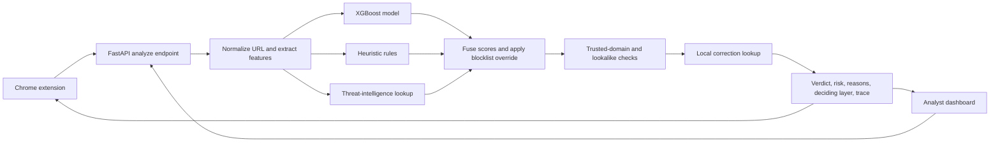
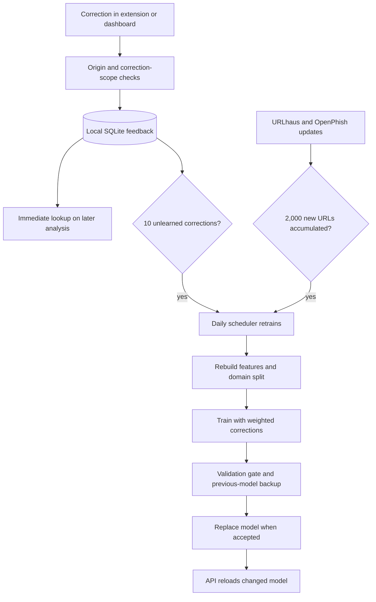

<div align="center">
  <picture>
    <source media="(prefers-color-scheme: dark)" srcset="browser-extension/icons/icon128.png">
    <source media="(prefers-color-scheme: light)" srcset="browser-extension/icons/icon128.png">
    
  </picture>

  <h1>DeepIntel</h1>
  <p>Investigate suspicious links with a verdict you can inspect and correct.</p>
</div>

<div align="center">
  <a href="#quick-start">Quick Start</a> ·
  <a href="docs/USAGE.md">Usage Guide</a> ·
  <a href="#evaluation">Evaluation</a> ·
  <a href="#contributing">Contributing</a>
</div>

---

<p align="center">
  
  
</p>

<p align="center">
  <a href="website/assets/product/product-promo.mp4">Open the product walkthrough (MP4)</a>
</p>

## Why DeepIntel?

If you are prototyping link screening or studying URL-classification decisions, DeepIntel gives you a local API, dashboard, and Chrome extension backed by one explainable detection engine. It is a research and demo system for local evaluation; its offline results are not a production security guarantee.

## What you can do

- Inspect the verdict, risk score, deciding layer, readable reasons, and model feature contributions for a URL.
- Catch lookalike domains and brand names hidden in untrusted subdomains.
- Review URLs from the dashboard or Chrome extension through the same local API.
- Correct false verdicts; corrections affect later analyses immediately and can be added to training.
- Rebuild and evaluate the model with a validation gate that keeps a known-good model when validation accuracy drops too far.

## Quick Start

Requirements: Python 3.12, pip, and Chrome if you want to use the extension. A fresh clone has no trained model artifacts, so create the label encoder and train once before starting the API.

```bash
git clone https://github.com/Vishwa-Koparkar/deepintel.git
cd deepintel
python3.12 -m venv venv
source venv/bin/activate
pip install -r requirements.txt
python - <<'PY'
import joblib
from sklearn.preprocessing import LabelEncoder

joblib.dump(LabelEncoder().fit(["benign", "malware", "phishing"]), "models/label_encoder.pkl")
PY
python scripts/pipeline/retrain.py
uvicorn api:app --reload
```

Open [the dashboard](http://localhost:8000/dashboard) or [the API docs](http://localhost:8000/docs). To use Chrome, load `browser-extension/` from `chrome://extensions` with Developer mode enabled; keep the API running on `localhost:8000`. See the [Usage Guide](docs/USAGE.md) for setup details, feedback behavior, evaluation, and data operations.

## Evaluation

The committed [system report](models/system_eval.json) evaluates 6,555 held-out URLs using the detection layers with the allowlist and personal feedback disabled.

| Measure | Result |
|---|---:|
| Accuracy | 92.75% |
| False-positive rate | 4.94% |
| False-negative rate | 8.64% |
| Split | 70/15/15 by domain-derived groups |
| Trailing-slash verdict changes | 0 |

| Class | Precision | Recall | Test URLs |
|---|---:|---:|---:|
| Benign | 95.5% | 95.1% | 4,309 |
| Malware | 97.8% | 90.5% | 798 |
| Phishing | 82.6% | 87.2% | 1,448 |

Phishing is the weakest class. The benign examples are synthetically augmented from Majestic Million domains, and the report is an offline dataset evaluation; it does not establish accuracy on live traffic or performance under production load. The API is configured for local development, with permissive analysis CORS and no authentication. Its feedback origin check is not authentication, so do not expose this service publicly as-is.

## Architecture

The API analyzes URL text without fetching the submitted page. It combines three scoring signals, then applies domain checks and any saved correction before returning an explanation and decision trace.



## Corrections and model updates

Corrections are stored locally in SQLite. They can change later verdicts immediately, and the retraining pipeline adds eligible corrections to the training split with extra weight. Threat-blocklisted URLs cannot be marked safe.



The scheduler checks for updates every 24 hours. Retraining rebuilds the feature and split files; when a model already exists, it keeps that model if validation accuracy would drop by more than one percentage point. The longer command reference is in [Usage Guide](docs/USAGE.md).

## Project showcase

The static overview and interactive walkthrough live in [`website/`](website/index.html). It can be previewed locally with `python3 -m http.server 4173 --directory website`; see the [hosting notes](docs/DEPLOYMENT.md) for the deployment plan.

## Contributing

Contributions are welcome. Open an issue to discuss a larger change, then send a pull request with a clear description of the change and how you checked it.

## License

The repository does not currently specify a license.

---

Crafted with [Readme Craft](https://github.com/motiful/readme-craft)
